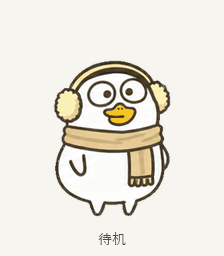

# Duckyo Scarf Codex pet

戴着浅黄色耳罩、米色围巾的小鸭 Codex 桌宠。保留原图的圆润身形、细短手臂，以及各角度一致的圆角倒三角小脚。

A cozy scarf duck companion for Codex, with nine animation states and sixteen look directions.



## 安装

下载并解压本仓库，或克隆到本地。在仓库文件夹中运行：

```bash
bash scripts/install.sh
```

默认安装到 `~/.codex/pets/duckyo-scarf/`。如果已设置 `CODEX_HOME`，则安装到该目录下的 `pets/duckyo-scarf/`。安装脚本仅复制 `pet.json` 和 `spritesheet.webp`，不联网，也不更改当前桌宠选择。

安装完成后，在 Codex 的桌宠选择界面中选择 **Duckyo Scarf Codex pet**。如果列表尚未刷新，请重新打开 Codex。

重新安装时，脚本会先把已有目标文件夹完整备份到旁边带时间戳的唯一备份文件夹，然后更新素材。

也可指定一个独立的安装目标目录：

```bash
DUCKYO_INSTALL_DIR="/path/to/pets/duckyo-scarf" bash scripts/install.sh
```

### 手动安装

将 `pet/` 中的两个文件复制到以下位置：

```text
~/.codex/pets/duckyo-scarf/
├── pet.json
└── spritesheet.webp
```

使用自定义 `CODEX_HOME` 时，将上面的 `~/.codex` 替换为对应目录。

## 预览与文件

- [全部动作 GIF](assets/all-states.gif) / [MP4](assets/all-states.mp4)
- [待机 → 弹跳 → 待机](assets/idle-jump-idle.gif)
- [十六方向视线循环](assets/look-loop.gif)
- [逐动作交互预览](assets/preview.html)：下载后在浏览器打开。
- [动作帧总览](assets/contact-sheet.png) / [方向帧总览](assets/look-directions.png)

```text
.
├── pet/
│   ├── pet.json                 # 桌宠信息
│   └── spritesheet.webp         # 无损透明动画图集
├── assets/
│   ├── all-states.gif
│   ├── all-states.mp4
│   ├── idle-jump-idle.gif
│   ├── look-loop.gif
│   ├── contact-sheet.png
│   ├── look-directions.png
│   ├── animation-stills.png
│   ├── preview.html
│   └── states/                 # 九种动作的单独 GIF
├── qa/                         # 随包保留的校验资料
└── scripts/install.sh
```

## 动画图集格式

图集采用 v2 格式，尺寸为 **1536 × 2288** 像素，RGBA 透明背景，无损 WebP。共 **8 列 × 11 行**，每格 **192 × 208** 像素；包含 73 个有效帧和 15 个留空格。

| 行（从 0 开始） | 动作 | 有效帧数 |
| --- | --- | ---: |
| 0 | `idle` 待机 | 6 |
| 1 | `running-right` 向右移动 | 8 |
| 2 | `running-left` 向左移动 | 8 |
| 3 | `waving` 挥手 | 4 |
| 4 | `jumping` 弹跳 | 5 |
| 5 | `failed` 失落 | 8 |
| 6 | `waiting` 等待 | 6 |
| 7 | `running` 思考 / 工作中 | 6 |
| 8 | `review` 查看 / 检查 | 6 |
| 9 | 视线方向 0°–157.5° | 8 |
| 10 | 视线方向 180°–337.5° | 8 |

视线以屏幕上方为 0°，按顺时针方向每隔 22.5° 一帧。身体比例、细手臂和小脚造型在各方向保持一致。
